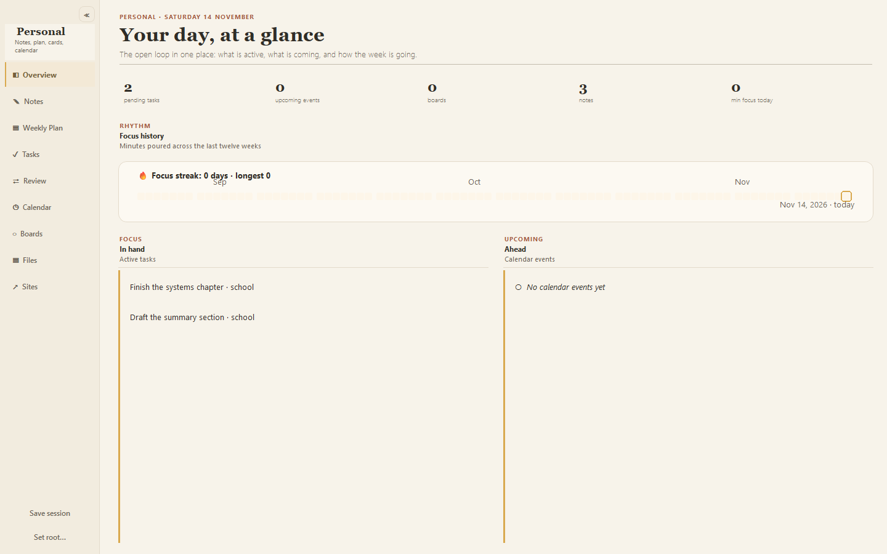

<div align="center">

# Mei

**A browser, a research desk and a study workspace in one window.**

Read a page, keep what matters, turn it into notes, a plan and flashcards — without
exporting your work into four other applications.

[](https://github.com/Annguyen0410/Mei/actions/workflows/ci.yml)
[](https://github.com/Annguyen0410/Mei/releases)
[](LICENSE)


**[Website](https://annguyen0410.github.io/Mei/)** ·
**[Download](https://github.com/Annguyen0410/Mei/releases)** ·
**[Changelog](docs/CHANGELOG.md)** ·
**[User guide](docs/USER_GUIDE.md)**



</div>

---

## What Mei is

Mei is a Windows desktop application built on Qt 6 and QtWebEngine. It is one
window with a browser on the left and the work that follows it on the right: save
the page to a research desk, leave a note on it, plan the week it belongs to, then
review it as flashcards.

Everything lives in a local profile. There is no account, no hosted storage and no
required network service — AI is opt-in, and the workspace is usable with every
network feature switched off.

<table>
<tr><td width="50%" valign="top">

**Browse with context**

Tabs, tab groups, split view, reader tools, downloads and incognito profiles, plus
optional web panels. A saved tab is a record you can link to, not a bookmark you
forget.

</td><td width="50%" valign="top">

**Keep the thread**

Research desks group the tabs, notes, tasks, saved pages and flashcards for one
question, and link the existing records instead of copying them.

</td></tr>
<tr><td valign="top">

**Plan and see what is next**

Home shows current work, due items and one suggested next step. The Weekly Plan
holds courses, deadlines and focus blocks; Calendar, Boards and Tasks are one
click away.

</td><td valign="top">

**Study what you kept**

Notes with wiki links, quick tasks and SM-2 spaced repetition. Quick Capture turns
the current page into a note, task, saved page or card in a single form.

</td></tr>
<tr><td valign="top">

**Ask about your own material**

Local retrieval, Ollama, llama.cpp or OpenRouter. Browser and research context are
separate opt-in switches, page content is treated as untrusted input, and
private-window content is excluded.

</td><td valign="top">

**Keep it yours**

Profile data stays on disk. The AI key, Google token cache, sync token, bridge
token and proxy password are protected with Windows DPAPI and are deliberately
left out of backups, sync and diagnostics.

</td></tr>
</table>

## Download

| | |
|---|---|
| **Installer** | `MeiSetup.exe` — Start Menu entry, optional desktop and taskbar icons, uninstaller |
| **Portable** | `Mei.exe` + `Mei-<version>-web_support.zip` — extract the archive beside the executable |
| **Updates** | Installed copies read `releases/latest/download/update.json`; pre-releases are published there for manual download only |

Download from **[GitHub Releases](https://github.com/Annguyen0410/Mei/releases)**.

The profile is stored outside the installation folder, so replacing or uninstalling
the application never deletes notes, tasks or cards. Back the profile up before
moving to another machine — see [Data Management](docs/audit/MEI_DATA_MANAGEMENT_GUIDE.md).

**Requirements:** Windows 10 or 11, 64-bit. The browser engine is bundled
(QtWebEngine 6.11 / Chromium 140); no separate runtime is installed.

## Run from source

Developed and tested with Python 3.11 on Windows.

```powershell
git clone https://github.com/Annguyen0410/Mei.git
cd Mei
python -m venv .venv
.\.venv\Scripts\python.exe -m pip install -r requirements.txt
.\.venv\Scripts\python.exe browser.py
```

Packaging, the PyInstaller invocation and platform troubleshooting are documented in
[`RUN_AND_BUILD.md`](RUN_AND_BUILD.md). Architecture and module boundaries live in
[`ARCHITECTURE.md`](ARCHITECTURE.md).

## Privacy

- No required account and no hosted data service; the profile is local.
- AI providers receive only the context you submit, and the two context switches are
  independent. Remote providers (such as OpenRouter) see the request you send them.
- `secrets.dat` is DPAPI-protected on Windows and excluded from backups, folder sync
  and diagnostics bundles. Logs are credential-redacted before they are written.
- The Mei passcode gates workspaces; it does not encrypt every file at rest.
  Encrypted backups are opt-in AES-256-GCM containers.
- The Android bridge listens on loopback by default. LAN mode is plain HTTP, warns
  before enabling, and a pairing code should be treated as a credential.

## Documentation

| Document | What it covers |
|---|---|
| [User guide](docs/USER_GUIDE.md) | Every workspace, screen by screen |
| [Command reference](docs/COMMAND_REFERENCE.md) | Slash commands, shortcuts, gestures |
| [Run and build](RUN_AND_BUILD.md) | Environment, packaging, common errors |
| [Architecture](ARCHITECTURE.md) | Layers, stores, threading model |
| [Changelog](docs/CHANGELOG.md) | Release notes for every version |
| [Why Mei](docs/WHY_MEI.md) | The design argument behind the app |
| [Data integrity audit](docs/audit/MEI_DATA_INTEGRITY_AUDIT.md) | Backups, restore, guarantees and risks |
| [Product website](website/README.md) | The marketing site in `website/` (not in the app bundle) |

## Development

```powershell
.\.venv\Scripts\python.exe -m pytest -p no:cacheprovider -q
.\.venv\Scripts\ruff.exe check --select F401,F811,F841,F821 litebrowser tests tools
```

GitHub Actions runs the suite on Windows and gates on the engine's security patch
version. The release workflow reruns the suite, builds the frozen executable,
stages `web_support`, compiles the installer, launches the packaged app against a
throwaway data root with `--smoke-test`, and only then publishes.

```text
browser.py                  Desktop entry point
litebrowser/core/           Product identity, preferences, storage, shared logic
litebrowser/services/       Research, AI, planning, sync, integrations
litebrowser/ui/             Browser shell and desktop workspaces
web_support/                Local web workspaces shipped beside the exe
Extensions/                 Mei browser extension
tests/                      Python regression suite (3400+ tests)
website/                    Product website, published from gh-pages
```

## Release process

The version lives in [`litebrowser/core/product.py`](litebrowser/core/product.py) and
release notes in [`docs/CHANGELOG.md`](docs/CHANGELOG.md); each must name the same
version. Pushing a `v<version>` tag starts the Windows release workflow, and
[`tools/publish_release.py`](tools/publish_release.py) refuses a tag that disagrees
with the build, a manifest whose hash is wrong, or a pre-release that would take over
`releases/latest`.

A tag with a suffix (`v1.0.3.0-alpha.1`) is published as a GitHub pre-release, which
installed copies never see. A stable release additionally requires a trusted,
Ed25519-signed update manifest (`MEI_UPDATE_KEY_ID`, `MEI_UPDATE_SIGNING_KEY`) and an
Authenticode-signed executable; without them the pipeline stops instead of shipping
something it cannot vouch for.

## License

MIT — see [LICENSE](LICENSE).
